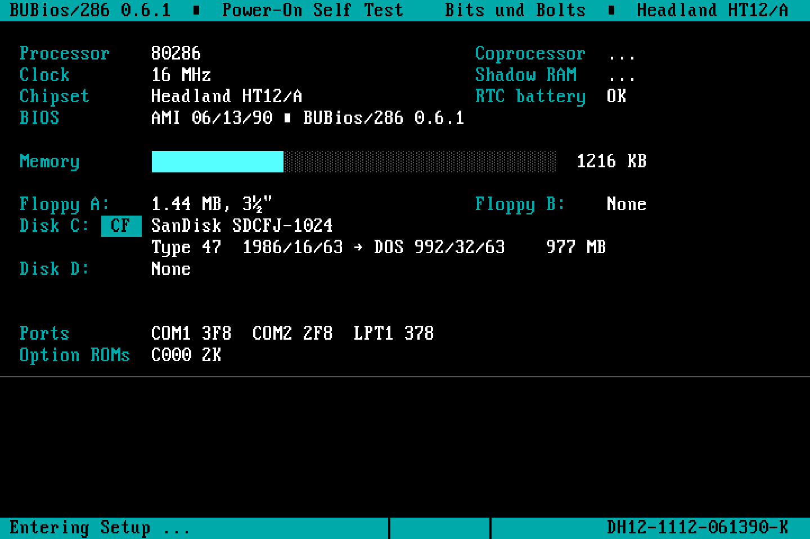
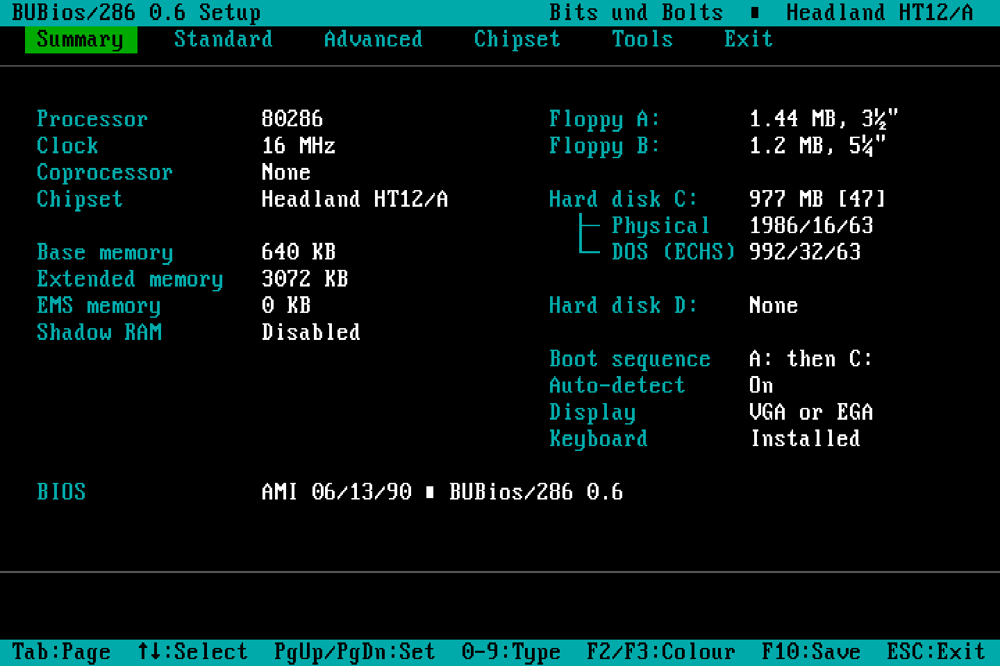
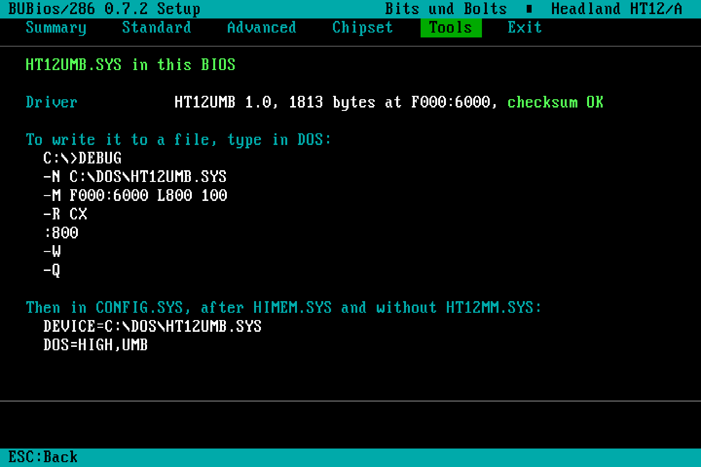
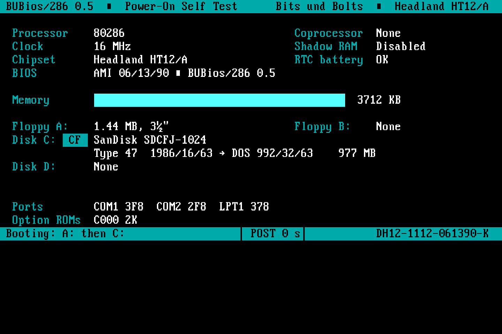

# FOX II 286 BIOS Patch

**An upgraded AMI 286 BIOS (06/13/90) for the Octek FOX II (Headland HT12/A): disks up to 8.4 GB, IDE auto-detection, a readable error instead of a silent hang on 386 code, a 386 boot floppy in A: skipped in favour of C:, and later a POST screen and a new setup with a boot-order option in the style of BUBios.**

This is the 286 sibling of the SOYO SY-019L1 project ([BitsUndBolts/SOYO_SY-019L1_504_Patch](https://github.com/BitsUndBolts/SOYO_SY-019L1_504_Patch), locally `P:\git\SOYO_SY-019L1_504_Patch`), which did the same for a 1992 AMI 386 BIOS. That project's guides and emulators are the starting point; this folder records what is different on a 286 and every step taken, so it can become a guide of its own.

**Status: Step 1 (ECHS) works on the board (1 GB card: existing DOS 6.22 install, reads, writes, boot from C:; the 2 GB and 8 GB cards are still to test). Step 2 (INT 06h message) works on the board (MS-DOS 7.1 boot floppy). Step 3 (IDE auto-detection) works on the board (detection, boot in the same POST, unplugged C: and D:); its second build fixes garbage after the copyright line on a warm boot. Step 4 (a 386 boot floppy in A: is skipped and C: boots) works on the board; it contains the second Step 3 build. Round 5a (the AMI ROM Diagnostics removed, 28 KB free), round 5b (the POST screen of BUBios/286) and round 6a (the setup of BUBios/286 with a boot order and the Auto-Detect switch) **work on the board as 0.6.1** (5a and 5b inside 6a; 0.6's five findings fixed; tested by Alex on 2026-11-19): merged into `main`. **Round 6b (the tools, HT12UMB.SYS in the ROM, the boot key, Base/XMS/EMS on the POST screen, the EMS memory-bar fix): **works on the board as 0.7.1** (all tools, HT12UMB.SYS written from the ROM and loaded, the EMS pages tested through the HT12 window); **0.7.2** only moves `Done.` in the memory test up to one row below the results. Squash-merged into `main` on 2026-11-19.**

## Plan

The work goes in small steps. Each one is tested in the emulator, then burned and tested on the board before the next starts.

| Stage | Step | What | Status |
|---|---|---|---|
| 0 | 0 | Map the original ROM, tools, this folder | done |
| 1 | 1 | **ECHS** translation: disks up to 8.4 GB through INT 13h CHS | **works on the board** (1 GB card); 2 GB / 8 GB cards to test |
| 1 | 2 | **Readable INT 06h error**: a 386 boot sector or program shows a message and halts (Ctrl+Alt+Del) instead of hanging silently | **works on the board** (MS-DOS 7.1 boot sector) |
| 1 | 3 | **IDE auto-detection** during POST, every boot: a drive set to "Not installed" in CMOS that answers IDENTIFY is written to CMOS as type 47 with its physical geometry; drives the user entered are never changed. Unplugged drives dropped for that boot. The setup tool and on/off switch come in stage 3. | **works on the board** (its second build runs inside the Step 4 ROM) |
| 1 | 4 | **386 boot floppy in A: -> boot C:**: an invalid opcode while booting from A: (before DOS is loaded) shows Step 2's message with "Drive A: skipped. Booting from C: ..." and the boot goes on with C:, no waiting; everything else still halts | **works on the board** (MS-DOS 7.1 floppy -> DOS 6.22 from C:) |
| 2 | 5a | Remove the AMI ROM Diagnostics (28 KB) to make room | **emulator tests pass, to burn** (branch `stage2-5a-no-diagnostics`) |
| 2 | 5b | Full-screen POST display in the style of BUBios | **emulator tests pass, to burn** (branch `stage2-5b-post-screen`) |
| 3 | 6a | BUBios-style setup: tabs, Summary page, no three-item menu, **boot order** option, auto-detect switch | 0.6 **works on the board**; **0.6.1** (board-test fixes) emulator tests pass, **to burn** (branch `stage3-6a-setup`) |
| 3 | 6b | Our own tools instead of AMI's (disk info, partition check, surface scan, memory test, chipset view, CMOS backup, disk speed: to decide with Alex) | **waiting for Alex's answers** (branch `stage3-6b-tools`) |

Stages 2 and 3 follow [`docs/PLAN_STAGES_2_3.md`](docs/PLAN_STAGES_2_3.md): one round per branch, each built on the one before; `main` only gets a round after its ROM is confirmed on the board.

Out of scope: LBA / INT 13h extensions (DOS 6.22 doesn't use them), and a 128 KB ROM.

Stage 1 fits in the existing free space (about 1.5 KB; Steps 1-4 use 1,443 bytes of it, and little is left: see ROM_ANALYSIS section 9). Round 5a removes the 28 KB of AMI ROM Diagnostics (F000:000B-6FFD) for stages 2 and 3.

## The ROMs

| ROM | What | MD5 (CPU image) | Status |
|---|---|---|---|
| `binary/FOXII_STEP6B.BIN` | round 6b (0.7.2): 6a + the tools, HT12UMB.SYS at F000:6000, the one-time boot key, the Base/XMS/EMS line, the EMS bar fix | `86a6a30af017c77d7042c0bd152bcdd2` | **works on the board** as 0.7.1 (`python3 py/build.py 6b`); 0.7.2 = 0.7.1 with `Done.` moved up in the memory test |
| `binary/FOXII_STEP6A.BIN` | round 6a (0.6.1): 5b + the setup, boot order, Auto-Detect switch, and the board-test fixes | `39f360b612da32e4b4517abea2d15343` | **works on the board** (`python3 py/build.py 6a` rebuilds it byte for byte); contains 5a and 5b |
| `binary/FOXII_STEP5B.BIN` | round 5b: 5a + the POST screen | `1676da04973658527b52e0da40fcaf06` | emulator tests pass, **to burn** (`python3 py/build.py 5b`) |
| `binary/FOXII_STEP5A.BIN` | round 5a: Step 4 without the AMI ROM Diagnostics | `50e1a3bec4e2ee652377b7ab632640a3` | emulator tests pass, **to burn** (`python3 py/build.py 5a`) |
| `binary/FOXII_STEP4.BIN` | Step 4: Step 3 + a 386 boot floppy in A: is skipped | `1e95b81057dc59e07d49f3f0d3993ecf` | **works on the board** (`python3 py/build.py 4` rebuilds it byte for byte) |
| `binary/FOXII_STEP3.BIN` | Step 3: Step 2 + IDE auto-detection (second build) | `1c05d1c2b53a2c5d7c72adc698e04770` | its code runs on the board inside the Step 4 ROM (the first build, `451fbb2b...`, printed garbage on a warm boot); `python3 py/build.py 3` rebuilds it |
| `binary/FOXII_STEP2.BIN` | Step 2: Step 1 + INT 06h message | `7b4a6577251b60668f24a6b80eb29af8` | **works on the board** (`python3 py/build.py 2` rebuilds it byte for byte) |
| `binary/FOXII_ECHS.BIN` | Step 1: ECHS | `16c21a46d4effa9a62beca3349633fc7` | **works on the board** (`python3 py/build.py 1` rebuilds it byte for byte) |
| `base/FOXII_0613_ORIGINAL.BIN` | the original BIOS | `c74e174c716add49b1b686c70d8df83c` | |

Burn the doubled chip files, not the CPU image, on 27C512 / 27SF512 chips: `<name>_EVEN.BIN` into the **EVEN** socket, `<name>_ODD.BIN` into the **ODD** socket.

| Chip file | MD5 |
|---|---|
| `binary/FOXII_STEP6B_EVEN.BIN` | `27e81a1df8f57a5c84c03a187d03ff38` |
| `binary/FOXII_STEP6B_ODD.BIN` | `d28d6379c10c01e4ad3375a1b5b28dd2` |
| `binary/FOXII_STEP6A_EVEN.BIN` | `ceefb346c0457b7e8f6ae5d2d710ad6f` |
| `binary/FOXII_STEP6A_ODD.BIN` | `5a1e26cda886db81c73325137479337b` |
| `binary/FOXII_STEP5B_EVEN.BIN` | `c1e01cbb2ff41c99fbc06672548756bc` |
| `binary/FOXII_STEP5B_ODD.BIN` | `a7c58aadd63e858784bdf70b8ba0e55f` |
| `binary/FOXII_STEP5A_EVEN.BIN` | `c2828b72e1be1acf65461ece0295f3ce` |
| `binary/FOXII_STEP5A_ODD.BIN` | `0bdf5ffd23c34c464de6f8c3272146ab` |
| `binary/FOXII_STEP4_EVEN.BIN` | `5c31714b2db90007750c23530960e402` |
| `binary/FOXII_STEP4_ODD.BIN` | `397fd67df97f56b363ab57014556c0e9` |
| `binary/FOXII_STEP3_EVEN.BIN` | `231810220033982169dc8fb92d64a7cf` |
| `binary/FOXII_STEP3_ODD.BIN` | `b2c6a76b5261b385ffea925f3244078d` |
| `binary/FOXII_STEP2_EVEN.BIN` | `1fc04e39a559d26077f597791497f5bf` |
| `binary/FOXII_STEP2_ODD.BIN` | `d02f56715ff84b076395f6004758a494` |
| `binary/FOXII_ECHS_EVEN.BIN` | `7a30d68611e1514da46828cb3d792dbf` |
| `binary/FOXII_ECHS_ODD.BIN` | `1b163bb1704f834ada271f769e6c923e` |

## Testing 0.6.1 on the board

0.6.1 is round 6a with the fixes from its first board test (DEVELOPMENT_LOG, round 6a, "Board test" and "0.6.1"). Burn `FOXII_STEP6A_EVEN/ODD.BIN` again; the POST screen and setup say `0.6.1`.

1. **DEL during the memory test:** the status bar says `Entering Setup ...` at once (it used to be lost there: AMI drops every key but ESC while it tests memory), and the setup follows after POST's device checks.
2. **DEL at `Press DEL to run Setup`** (and a little later, while the disks are set up): `Entering Setup ...` within a timer tick (55 ms).
3. **The step into setup:** the screen goes dark for a moment and then shows the Summary page; AMI's page must not flash any more. Same with a monochrome card if you have one.
4. **ESC during the memory test** still skips it.
5. **Without DEL:** a normal boot; one empty row between the status bar and `Starting MS-DOS...`.
6. **Auto-Detect On, C: Not Installed:** during the memory test the row under the model says `Auto-Detect sets it up after the memory test`, then (just after the memory test) `Auto 1986/16/63 -> DOS 992/32/63 977 MB`; C: boots. Afterwards set C: back to type 47 if you want (Tools, or it stays type 47 from the auto-detect). **Off:** `Not set up (Auto-Detect Disks at Boot is Off)` as before.
7. Optional: a run of the 6a list below, to be sure nothing else moved.



## Testing round 6a on the board

What round 6a does: DEL goes straight to the new setup (BUBios/286 0.6), AMI's three-item menu is gone. Pages: **Summary** (what the BIOS sees), **Standard** (date, time, floppies, disks with type-47 parameters, display, keyboard), **Advanced** (boot sequence, Auto-Detect Disks at Boot, colour scheme), **Chipset** (AMI's HT12 options, EMS size included), **Tools** (auto-detect C:/D: now), **Exit** (save, or exit without saving). AMI's own code still loads and saves the settings; the emulator proved that every option writes the same CMOS as AMI's page did. The clock keeps running in setup. New settings live in CMOS 3Eh/3Fh (outside AMI's checksum); a cleared CMOS gives the defaults (A: then C:, Auto-Detect On, Teal).



Burn `FOXII_STEP6A_EVEN/ODD.BIN` (it contains 5a and 5b; their board tests above apply too), then:

1. **Cold boot without DEL.** The POST screen as in 5b, but `0.6`; status at the end `Booting: A: then C:`; DOS 6.22 from C:. Nothing waits.
2. **DEL** at `Press DEL to run Setup`: the Summary page (in 0.6 AMI's page flashed first; 0.6.1 hides it). Check: 80286, the clock, None, 640/3072 KB, C: `977 MB [47]`, `1986/16/63`, `992/32/63`, the boot settings. Floppy B: (board, 0.6): `Not Installed`, as it should be; the emulator's 1.2 MB was the emulator's own BIOS data area.
3. **Every page** with Tab and Shift-Tab; ↑↓ moves, PgUp/PgDn changes, the help line follows. **Chipset** must show the same values AMI's page had (shadow, scratch RAM 1, EMS, 0 wait state, relocation); EMS maximum and extended memory below.
4. **Date and time:** on Standard type e.g. `11202026` for the date and a time as `hhmmss`; they are set at once (no save needed), the time keeps running on the page. An impossible date (`02302026`) says `Not taken`.
5. **Exit without saving** (Exit page, Enter, Y): POST goes on, the POST screen is drawn again, DOS boots. Re-enter setup: nothing changed.
6. **Save:** change the colour scheme (F3 or Advanced), F10, Y: the PC restarts, the POST screen and the setup are in the new colours. Set it back the same way. Also try `C: then A:` with the MS-DOS 7.1 floppy in A:: DOS 6.22 boots from C: and the floppy is not touched; the status says `Booting: C: then A:`. Then `C: only`.
7. **Tools:** "Auto-detect hard disk C: now" says `Found: written as type 47 ...`; the Standard page shows 1986/16/63; leave without saving (or save: nothing changes for the CF card).
8. **Auto-Detect Off** (Advanced), C: set to Not Installed, save: the POST screen says `Not set up (Auto-Detect Disks at Boot is Off)` under the card's model, and the boot cannot use C:. Then switch it On again and save: the next POST shows `Auto` and boots C:. Set C: back to type 47 1986/16/63 if needed (Tools does it).
9. **HT12UMB / HT12MM.SYS** with the EMS size you use: works as before (the EMS option is AMI's, same CMOS bytes).
10. Optional, a monochrome card: the setup in black and white, F2/F3 do nothing.

What would point at the ROM: a hang after DEL or after Y (the restart), the clock standing still in setup or after it, a saved option that POST does not apply (compare with AMI's page values from 5b), DOS failing to boot after "Exit without saving", or a CMOS checksum error at the next POST.

## Testing round 6b (0.7) on the board

Burn `FOXII_STEP6B_EVEN/ODD.BIN` (it contains 0.6.1). The POST screen and setup say `0.7.2`.

**0.7.1, what is new against the 0.7 board test:** Disk info C: must now say `Setup Type 47 1986/16/63`, `BIOS gives DOS 992/32/63` and `Setup's geometry is the drive's own.` (0.7 looked at the wrong drive once the card reported PIO 4); Disk speed and Memory test end with `Done.`; the HT12UMB page says just "DOS" and has an empty row before the CONFIG.SYS part. The rest passed on 0.7: 2405 KB/s and 0.7 ms on the 1 GB card, memory OK, HT12UMB.SYS written by DEBUG and loaded (64 KB UMB at C800-D7FF).
 Details of every part: `docs/DEVELOPMENT_LOG.md`, "Round 6b (0.7)".

1. **POST screen:** under the memory bar a new line `Base 640 KB   XMS 3072 KB   EMS None`. Set an EMS size in setup (Chipset), save: the next POST shows e.g. `XMS 2048 KB   EMS 1024 KB`, and **the bar runs to the end of the count** (0.6 stopped at about 70% here and jumped at the end).
2. **Boot key:** press **C** during POST (memory test or the DEL window, which now says `DEL: Setup   A/C: boot from A:/C:`) with a boot floppy in A: and `A: then C:`: the status bar says `Booting: C: (this time)` and DOS boots from C:. The next boot uses the setup's order again. **A** the same with `C: then A:` or `C: only`. Nothing waits for a key.
3. **Setup, Tools** has eight entries now:
   - **Hard disk C: info / auto-detect:** model (`CF card`), serial, firmware, geometry, 2001888 sectors / 977 MB for the 1 GB card, PIO mode, multiple sectors; setup's entry `Type 47 1986/16/63`; `BIOS gives DOS 992/32/63`; `Setup's geometry is the drive's own.` Enter would auto-detect as type 47 (the old Tools entry). Compare the values with WHATIDE if you like. D: says no drive answers.
   - **Partition check C:** the 1 GB card's DOS 6.22 partition(s), each `OK`, and `The partitions fit the geometry this BIOS gives DOS.` For the warning, use a card partitioned elsewhere with another head count (your P2B card from Step 1 was one): rows marked `!`, `Made with 32 heads / ...`, and on the next POST a line under the disks `C: partitions use ... - see Setup, Tools`. Nothing is ever written.
   - **Disk speed C:** about 6 s; three `KB/s` readings and an access time. These are the first real numbers for this board (the emulator's are made up); please note them.
   - **Memory test:** base 68-640 KB, extended, and with an EMS size set the **EMS pages** through the HT12 window (`C0-FFh  window D000` or another free block). A pass takes some seconds per MB; ESC stops it. Every area should say `OK`.
   - **Get HT12UMB.SYS:** `HT12UMB 1.0, 1813 bytes at F000:6000, checksum OK` and the DEBUG recipe below. Try the recipe in DOS, then load the file instead of your copy of HT12UMB.SYS: same result as before (64 KB UMB).
4. **After the tools**, Exit without saving: POST goes on and DOS boots (the tools leave setup's stack alone; this was a real bug in the emulator's first run).
5. **HT12MM.SYS (EMS)** after the memory test of the EMS pages: still works (the test restores the HT12's registers 19h and 20h).

What would point at the ROM: a hang in a tool or after leaving it, a memory test error on RAM that HIMEM / HT12UMB / CheckIt find good, a partition check that marks a card DOS reads fine, a speed far from what DOS tools measure, a boot key that is ignored or that still acts on the next boot.

## HT12UMB.SYS from the BIOS

Since 0.7 the BIOS carries Alex's UMB driver ([BitsUndBolts/HT12UMB](https://github.com/BitsUndBolts/HT12UMB), version 1.0, `extra/HT12UMB.SYS`) in a fixed 2 KB slot at **F000:6000**. DOS loads drivers only from files, so it is written out once with DEBUG (it comes with DOS):

```
C:\>DEBUG
-N C:\DOS\HT12UMB.SYS
-M F000:6000 L800 100
-R CX
:800
-W
-Q
```

`M` copies the slot (2 KB: the driver and zeros) to DEBUG's buffer, `R CX` sets the file length, `W` writes it. The recipe never changes between BIOS or driver versions; the zeros after the driver do no harm (DOS keeps only what the driver's init asks for). Then, as usual, after HIMEM.SYS and without HT12MM.SYS:

```
DEVICE=C:\DOS\HIMEM.SYS
DEVICE=C:\DOS\HT12UMB.SYS
DOS=HIGH,UMB
```

Setup shows the same recipe under Tools, "Get HT12UMB.SYS", with the version and a checksum of the slot.



## Testing round 5b on the board

What round 5b does: POST shows one full screen (BUBios/286 0.5) instead of AMI's lines and the System Configuration box. POST itself is unchanged (the emulator compares the POST checkpoints, CMOS, vectors and BDA with round 5a in every case). No countdown and no pause: when POST ends, the screen stays up, the status bar moves up to row 17 (in place of the separator line), and the boot (Step 4's message, `Starting MS-DOS...`) continues below it, scrolling the screen up as DOS writes.



Burn `FOXII_STEP5B_EVEN/ODD.BIN`, then:

1. **Cold boot, every row.** Right after the Paradise sign-on the screen appears. Note what it shows, especially:
   - `Clock`: a standard clock (`16 MHz`, `20 MHz`, ...) or `about n MHz` (then please note n: the measurement needs calibrating);
   - `Memory`: the bar fills while AMI counts, to `3712 KB`; the status line says `Press ESC to skip the memory test` meanwhile;
   - `Disk C:  CF  SanDisk SDCFJ-1024` and below it `Type 47  1986/16/63 → DOS 992/32/63    977 MB`;
   - `Coprocessor` and `Shadow RAM` show `...` until the end of POST, then `None` and what the HT12 has (`Main + Video`, `Main`, `Video` or `Disabled`, as set in setup);
   - `Ports COM1 3F8  COM2 2F8  LPT1 378` (or what the I/O card has), `Option ROMs C000 32K` (the Paradise BIOS size);
   - the status bar: `Checking devices ...`, then `Press DEL to run Setup`, at the end `Booting: A: then C:`, `POST n s`, and on the right `DH12-1112-061390-K` with the keyboard controller's version letter.
   Then DOS 6.22 starts from C:, its text below the separator. Nothing waits.
2. **DEL** while the status says `Press DEL to run Setup`: AMI's menu (two items, as in 5a). `EXIT FOR BOOT`: the POST screen is drawn again (no POST time) and DOS boots. `RUN CMOS SETUP`, ESC, Y, Enter: saved, a full POST.
3. **The MS-DOS 7.1 floppy in A:** Step 4's message (`Invalid opcode ...`, `Drive A: skipped. Booting from C: ...`) appears below the POST information, readable, then DOS from C:.
4. **Warm boot** (Ctrl+Alt+Del): the same screen, memory `3712 KB` (the count itself is skipped on a warm boot).
5. **Auto:** set C: to "Not installed" in setup, save: the next POST shows `Auto  1986/16/63 ...` for C: and boots it. (From the boot after that it shows `Type 47`: Step 3 wrote type 47.)
6. **DOS still fine:** `DIR A:`, `DIR C:`, a file copy. Optional, through DOSAI: 40:F0-40:FF all 00, 40:8E = 00.
7. Optional: **ESC** during the memory count skips it as before; card unplugged with C: type 47: `Not found (left out for this boot)` and no waiting.

What would point at the ROM: a hang or a black screen after the video sign-on (checkpoint 22h: the screen is drawn there), `Disk C:` stuck at `...` or `No answer to IDENTIFY` with the card in, garbled colours (wrong attribute table), DOS failing to read C: on the first access after POST (an IRQ 14 left over: 40:8E), or text of AMI's old screens appearing.

## Testing round 5a on the board

What round 5a does: the AMI ROM Diagnostics (F000:0000-6FFF) are gone, and the setup menu no longer offers RUN DIAGNOSTICS. Nothing else may change: POST, its screen, the System Configuration box, the setup page and the boot are exactly as with the Step 4 ROM (the emulator compares all of them). The module's own checksum still runs and still has to pass.

Burn `FOXII_STEP5A_EVEN/ODD.BIN`, then:

1. **Cold boot.** POST as before, no `ROM-BIOS CHECKSUM ERROR`, the System Configuration box as before (80286, None, 640 KB, 3072 KB, type 47, 3F8,2F8, 378), DOS 6.22 starts from C:.
2. **DEL during the memory count.** The menu shows two items, `EXIT FOR BOOT` (highlighted) and `RUN CMOS SETUP`, and no `RUN DIAGNOSTICS`.
   - `RUN CMOS SETUP` shows the setup page as before. ESC asks `Write data into CMOS and exit (Y/N)?`; N + Enter goes back to the page; Y + Enter saves and restarts, and POST boots DOS.
   - `EXIT FOR BOOT` boots.
3. **Warm boot** (Ctrl+Alt+Del): as before, the line after `286-BIOS (C)1989 American Megatrends Inc` stays empty.
4. **Step 4 still works:** the MS-DOS 7.1 floppy in A: shows the message and boots C:.
5. Optional, through DOSAI: `F000:0000` = `AA 55 40 C3 90 90 00 00 E9 F5 6F`, `F000:6FFE` = `FC F3`, `F000:E058` = `00`.

What would point at the ROM: `ROM-BIOS CHECKSUM ERROR` or a stop at POST code 02 (a bad burn of the low or the high half), a missing configuration box, or `RUN DIAGNOSTICS` still in the menu (an old chip in one socket).

## Testing Step 4 on the board

What Step 4 does: when 386 code is hit while the BIOS boots from A:, before DOS is loaded (the boot sector, or a loader it started), Step 2's message appears with a new last line, `Drive A: skipped. Booting from C: ...`. The boot then goes on with C: at once, as if A: held no disk. Every other invalid opcode still halts with Step 2's message, including one in a program under DOS and one in a C: boot sector.

Burn `FOXII_STEP4_EVEN/ODD.BIN`, then:

1. **The annoyance gone.** Put the MS-DOS 7.1 boot floppy in A: (Gotek) and cold boot. This must appear:

   ```
   Invalid opcode at 0000:7DF6 (boot sector)
   Bytes: 66 6A 00 E9 3B FF
   The 80286 cannot run this code. It needs a 386 or newer CPU.
   Drive A: skipped. Booting from C: ...
   ```

   Then MS-DOS 6.22 must start from C: with no pause, and with DOSAI up as usual (its own startup lines appear below the message).
2. **Floppy use under DOS afterwards.** `DIR A:` with a normal DOS diskette works; the BIOS diskette parameters were put back.
3. **Warm boot** (Ctrl+Alt+Del) with the same floppy: the same as 1. Also the Step 3 check: the line after `286-BIOS (C)1989 American Megatrends Inc` stays empty.
4. **A good boot floppy** (MS-DOS 6.22 or 5) still boots from A:.
5. **A program still halts:** `C:\TEMP\T386.COM` shows the message with `System halted` (no `skipped`).
6. Optional: the 386 floppy in A: and C: set to "Not installed" with no card. After the message, AMI's own `INVALID BOOT DISKETTE` / `Insert BOOT diskette in A:` must follow; change the disk and press a key.

What would point at the ROM: a hang after `Booting from C: ...`, C: not starting, floppy errors under DOS, or the message on a program under DOS without `System halted`.

## Testing Step 3 on the board

What Step 3 does at every boot:
- **Not installed and answering:** a drive set to "Not installed" that answers IDENTIFY is written to CMOS as type 47 with its physical geometry, and the CMOS checksum is fixed. This happens before the BIOS sets up the disks, so it boots in the same POST.
- **Your entries:** drives you entered are never touched.
- **Configured but silent:** a drive for which nothing answers on the bus is left out **for this boot only**. CMOS keeps your entry. POST then does not wait (40 s for a missing D: in the emulator) and stops with no error.

Nothing changes on screen, and setup is unchanged.

**Keep the 1 GB card's geometry in mind.** It was partitioned with 32 heads under ECHS from its physical 1986/16/63, which is exactly what auto-detection writes, so setting it to "Not installed" is safe. Never do that with a card partitioned under another geometry (for example one entered as 1024/16/63): auto-detection would give it its physical geometry and its partitions would no longer be readable.

In this order:

0. **Warm boot (Ctrl+Alt+Del):** the line after `286-BIOS (C)1989 American Megatrends Inc` must stay empty (the first build printed `Φ9£rk╕` there).
1. **Nothing changed for your entries.** Burn `FOXII_STEP3_EVEN/ODD.BIN`. CMOS still says C: type 47 = 1986/16/63, D: Not installed: POST and boot from C: as before, with no extra delay.
2. **Auto-detect C:.** In setup set C: to "Not installed", save. The PC restarts, and POST must detect the card and boot DOS 6.22 from C: in the same boot. Then check that:
   - setup shows C: as type 47, 1986/16/63;
   - through DOSAI, CMOS 12h = F0h, 19h = 2Fh, 1Bh-23h = `C2 07 10 FF FF 08 C2 07 3F`, and no "CMOS checksum error".
3. **Unplugged C:** (power off, unplug the card or the cable). POST must go through without the long wait and without "HDD controller failure", and then boot from A: or report no boot disk. Setup must still show C: as type 47, 1986/16/63. Power off, plug the card back in: boots from C:.
4. **Unplugged D:.** With the card as C:, set D: to any type 47 (for example 980/16/32) and save. POST must not wait 40 s or show a D: error, and C: boots. Set D: back to "Not installed".
5. Optional, together with the open Step 1 test: the **2 GB card** set to "Not installed" must be detected with its physical geometry (e.g. 3875/16/63, DOS sees 967/64/63); then FDISK, FORMAT, SCANDISK as in Step 1 test 3.

What would point at the ROM: a hang or a long pause at POST, "CMOS checksum error" after a detection, a drive detected with the wrong geometry, a hand-entered type that changed, or C: not booting in the same POST it was detected in.

## Testing Step 2 on the board

Two tiny programs on the C: card (`C:\TEMP`), each a 386 instruction (`66 31 C0`, XOR EAX,EAX) and an exit:

1. `C:\TEMP\T386.COM`: with the Step 1 ROM the PC freezes silently; with the Step 2 ROM it must show `Invalid opcode at xxxx:0100`, the bytes `66 31 C0 CD 20 ..`, the 386 notice, and halt. **Ctrl+Alt+Del** must restart the PC.
2. `C:\TEMP\T386G.COM`: switches to VGA mode 13h first; the message must appear in text mode.
3. Optional: a boot floppy (Gotek image) whose boot sector contains 386 code must show the message with `(boot sector)`.
4. Everything from Step 1 still works: boot from C:, `DIR`, a file copy.

## Testing Step 1 on the board

In this order; each test depends on the one before. Keep the original chips at hand.

1. **An existing installation.** The 1 GB card with DOS 6.22 (SanDisk SDCFJ-1024, physical 1986/16/63). The ECHS ROM shows it to DOS as 992/32/63. What matters is the head count the partition was created with: read the MBR (DEBUG, INT 13h AH=02h of 0/0/1 to 0000:0200, then `d 3be l 10`) and look at the 6th byte of the first entry, the end head. `1F` = 32 heads: keep CMOS at 1986/16/63, and the card must boot as before. `0F` = 16 heads (partitioned under the original BIOS): enter 1024/16/63 instead, which the ECHS ROM does not translate. Never let a repair tool write to a card while the geometry is in doubt.
2. **Floppy boot with a disk configured** does not hang (SOYO pitfall 9.1 showed up exactly there).
3. **A translated disk: the 2 GB card.** Enter its **physical** geometry as type 47. The SOYO with BUBios shows it on its POST screen, or use the card's label. A 3875/16/63 card, for example, appears to DOS as 967/64/63. Then `FDISK` (one primary partition, active), `FORMAT C: /S`, boot from C:, copy files, `SCANDISK` with a surface scan.
4. **The far end of a large disk: the 8 GB card**, e.g. 16000/16/63 -> 1002/255/63, 7.68 GiB. DOS 6.22 limits each partition to 2 GB, so make a primary partition plus an extended partition with logical drives up to the end of the disk. Format, fill and surface-scan the **last** logical drive: that proves the high cylinder bytes.
5. Optional: the 4 GB card (128 heads).

What would point at the ROM: "C: drive error" or "C: drive failure" at POST, a hang during the floppy boot, "Invalid drive specification", or FDISK seeing a wrong size. Once a card's type-47 geometry has more than 1024 cylinders, changing it later changes the translation and its partitions become unreadable. The same happens if the 1 GB card is later given its real geometry (above 1024 cylinders): repartition it then.

## Folder

```
README.md                  this file: plan and status
CLAUDE.md                  notes for AI assistants working in this repository
docs/ROM_ANALYSIS.md       verified map of the original ROM (Step 0)
docs/286_BIOS_MODDING_GUIDE.md   the method, written as we go
docs/DEVELOPMENT_LOG.md    every step, every test, every bug
docs/PLAN_STAGES_2_3.md    the plan for stages 2 and 3: rounds, branches, the tool candidates
base/                      original chip dumps and the 64 KB CPU image
binary/                    built ROMs (CPU image + doubled EVEN/ODD chip files)
asm/step1.asm .. step4.asm what each step's ROM contains (+ listings; step3/4.map: where the sections went)
asm/echs.asm               Step 1: ECHS translation, 286 code
asm/int6.asm               Step 2: the invalid-opcode message
asm/autodet.asm            Step 3: IDE auto-detection (two blocks: 7F0F, E32D)
asm/bootskip.asm           Step 4: a 386 boot floppy in A: is skipped (four blocks: F474, 7EBA, DFBB, 7FD4)
py/build.py                assemble + patch + split; build.py 1 / 2 = the confirmed ROMs, no argument = newest
py/ide_harness.py          Unicorn emulator for the ROM's INT 13h code
py/regress.py              Step 1 tests: geometry, addressing, A/B identity, POST sequence, stack
py/boot_test.py            the ROM's INT 19h boot path from the simulated disk
py/int6_test.py            Step 2 tests: 386 boot sector, graphics mode, AMI's LOCK case
py/autodet_test.py         Step 3 tests: POST checkpoints 75h-76h with simulated CMOS, IDE bus and clock
py/bootskip_test.py        Step 4 tests: INT 19h with a 386 boot floppy, a C: disk, the 286's INT 06h
py/int6_harness.py         the 286's INT 06h and a video stub for Unicorn (used by int6_test and bootskip_test)
py/rom_checks.py           runs the BIOS's own checksum and tamper-check routines on an image
py/romtool.py              join / split / check EVEN+ODD chip images
py/analyze_bios.py         asserts every fact in ROM_ANALYSIS.md
py/coverage_disasm.py      recursive disassembly; proves nothing calls the diagnostics
py/post_emu.py             the whole POST from reset to INT 19h in Unicorn (286, HT12, no 287; from the SOYO's)
py/nodiag_test.py          round 5a tests: A/B POST against Step 4, setup menu, module watch, mutations
py/postscreen_test.py      round 5b tests: the POST screen in 16 cases, A/B POST against 5a, the boot, mutations
asm/post.asm, step5b.asm   round 5b: the POST screen (in the old diagnostics area, 000B-)
asm/setup.asm, step6a.asm  round 6a: the setup, boot order, Auto-Detect switch (after the POST screen)
py/setup_test.py           round 6a tests: every option A/B against AMI's page, typing, save/exit, boot orders, mutations
py/shots.py, py/vgafont.py screenshots from the emulator into shots/ (VGA font by VileR, CC BY-SA 4.0)
shots/                     screenshots per round (5a_*, 5b_*: POST screen, 6a_*: every setup page colour and mono, schemes, boot)
```

## Base ROM

| File | What | MD5 |
|---|---|---|
| `base/FOXII_0613_ORIGINAL.BIN` | 64 KB CPU image (F000:0000 = offset 0) | `c74e174c716add49b1b686c70d8df83c` |
| `base/ORIG_EVEN.BIN` | EVEN chip (low bytes), 64 KB doubled | `1bcd22853e656c19ee65670aad8fe1b7` |
| `base/ORIG_ODD.BIN` | ODD chip (high bytes), 64 KB doubled | `42824741ba95e0f09630d493d4e2371e` |

## Tools

Python 3. `py/analyze_bios.py` and `py/romtool.py` need nothing else. The builds need [NASM](https://www.nasm.us) (assembled with `CPU 286`, so a 386 instruction is an assembler error), and the emulator tests need Unicorn and Capstone (`pip install unicorn capstone`).

```sh
python3 py/build.py                        # newest round -> binary/FOXII_STEP6B.BIN + _EVEN/_ODD chip files
python3 py/build.py 5a                     # round 5a
python3 py/build.py 5b                     # round 5b
python3 py/build.py 6a                     # round 6a
python3 py/build.py 6b                     # round 6b (this branch)
python3 py/build.py 1                      # Step 1 ROM, checked against the board-confirmed MD5
python3 py/build.py 2                      # Step 2 ROM, checked against the board-confirmed MD5
python3 py/regress.py                      # ECHS tests on the newest ROM (FOXII_ROM=... for another)
python3 py/int6_test.py                    # Step 2 tests
python3 py/autodet_test.py                 # Step 3 tests (about 35 s)
python3 py/bootskip_test.py                # Step 4 tests
python3 py/nodiag_test.py                  # round 5a tests (about 3 min; --mutants: broken ROMs must fail, 10 min)
python3 py/postscreen_test.py              # round 5b tests (about 5 min; --mutants: 10 min)
python3 py/setup_test.py                   # round 6a tests (about 15 min; --mutants: ten broken ROMs, 12 min)
python3 py/tools_test.py                   # round 6b tests (about 15 min; parts: umb bar screen info part speed mem stack bootkey)
python3 py/post_emu.py                     # one POST from reset, prints the final screen
python3 py/shots.py 5a 5b 6a 6b            # screenshots into shots/
python3 py/boot_test.py                    # INT 19h boot path
python3 py/rom_checks.py                   # the BIOS's own checksum routines (also run by build.py)
python3 py/analyze_bios.py                 # check the original ROM map
python3 py/romtool.py split binary/X.BIN binary/X   # -> X_EVEN.BIN / X_ODD.BIN to burn
```

**Burning:** EVEN file into the EVEN socket, ODD file into the ODD socket. Keep the original chips. This BIOS has no recovery block.

## License

The patch sources, scripts and documentation are released under the MIT License (see `LICENSE`).

The ROM images in `base/` and `binary/` contain AMI BIOS code, which remains the copyright of American Megatrends Inc. They are provided for the preservation and repair of this board only.
